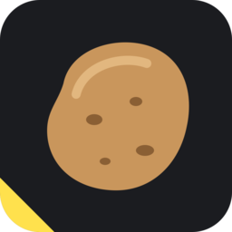

# Templates Unraid de MrPatates

[English](README.md)

Ce dépôt publie les templates Community Applications des apps Unraid de MrPatates. C'est le seul dépôt inscrit dans le store. Chaque app garde son code, sa documentation, son suivi des problèmes et la source de son template dans son propre dépôt.

| App | Type | Code et support |
| --- | --- | --- |
| **Endfield-Check-in** : check-in quotidien SKPORT automatique pour Arknights: Endfield | Docker | [MrPatates/endfield-checkin](https://github.com/MrPatates/endfield-checkin) |
| **THERMALRIGHT DIGITAL** : pilote de l'écran du Thermalright Peerless Assassin 140 Digital | Plugin | [MrPatates/thermalright-digital-unraid](https://github.com/MrPatates/thermalright-digital-unraid) |

Installe-les depuis l'onglet **Apps** d'Unraid. Signale les problèmes dans le dépôt de chaque app.

## Fonctionnement

- [`sources.json`](sources.json) indique d'où vient chaque template.
- Le workflow **Sync templates** tourne toutes les 6 h, ou à la demande depuis l'onglet Actions. Il recopie chaque template depuis le dépôt de son app, réécrit le `<TemplateURL>` des templates Docker pour qu'il pointe vers la copie d'ici, vérifie tout, puis commite les changements.
- Ne modifie pas `templates/` ni `plugins/` à la main : change le template dans le dépôt de l'app, puis lance **Sync templates**.
- [`scripts/validate.py`](scripts/validate.py) vérifie les exigences du store : structure XML, champs obligatoires, `TemplateURL`, noms uniques, secrets masqués et `ca_profile.xml`. Avec `--online`, il vérifie aussi que chaque lien répond et que chaque image Docker se télécharge sans identifiants.

Pour ajouter une app, ajoute une entrée dans `sources.json`, puis lance `python3 scripts/sync.py && python3 scripts/validate.py --online`.

GitHub désactive les workflows planifiés d'un dépôt public après 60 jours sans activité. Dans ce cas, réactive **Sync templates** dans l'onglet Actions.

Licence : MIT pour ce dépôt. Chaque app a sa propre licence.
